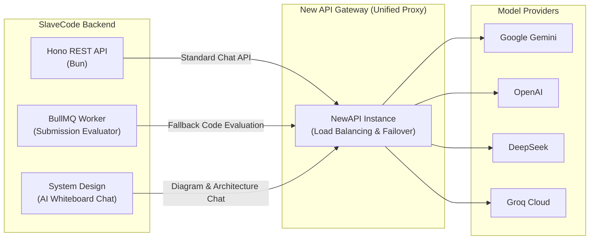

# ⚡ New API Gateway (LLM Reverse Proxy)

This document outlines the architecture, deployment, and integration of the **New API Gateway** (NewAPI) within the SlaveCode ecosystem.

---

## 🎯 Overview

The **New API Gateway** acts as the high-performance, unified AI reverse proxy router for SlaveCode. Instead of hardcoding vendor-specific SDKs across multiple microservices and background workers, all AI capabilities interface with a single standardized, OpenAI-compatible gateway.

### Supported Model Providers
* **Google Gemini** (Gemini 1.5 Pro, Gemini 1.5 Flash, Gemini 2.0)
* **OpenAI** (GPT-4o, GPT-4o-mini)
* **DeepSeek** (DeepSeek-V3, DeepSeek-R1)
* **Groq Cloud** (Llama 3.3 70B, Mixtral 8x7B)
* **Anthropic Claude** (Claude 3.5 Sonnet)

---

## 🏗️ Architecture & Role in SlaveCode

---

## 🔑 Key Capabilities

1. **Automated Multi-Stage Fallback**:
   If an AI provider experiences rate limits (429) or transient timeouts (5xx), New API Gateway automatically reroutes the request to a standby model (e.g., DeepSeek ➔ Gemini ➔ Groq) with zero downtime to the end user.
2. **Standardized Token Tracking & Rate Limiting**:
   Maintains centralized request quotas, spending limits, and token usage analytics across development and production environments.
3. **Low-Latency Streaming**:
   Native Server-Sent Events (SSE) streaming support for real-time AI Tutor responses on Roadmaps and interactive architecture discussions in the System Design workspace.
